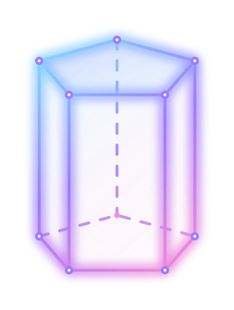

<p align="center"></p>

<h1 align="center">Prisma Harness</h1>

<p align="center"><em>Un prisma parte una luz en vías separadas. PRISMA toma una afirmación y la fuerza por rutas independientes hasta que sobrevive o se cae.</em></p>

<p align="center">
  
  
  <a href="https://github.com/juanquijandria/prisma-harness/actions/workflows/selftests.yml"></a>
  <a href="LICENSE"></a>
</p>

<p align="center"><sub><a href="README.md">English</a> · Español</sub></p>

<p align="center">
  <a href="#instalar"><b>Instalar</b></a> ·
  <a href="#los-pasos-y-sus-skills"><b>Los pasos</b></a> ·
  <a href="docs/es/METHOD.md"><b>El método</b></a> ·
  <a href="docs/reference.md"><b>Referencia</b></a>
</p>

<p align="center"></p>

PRISMA es un método de verificación para el trabajo que produce un agente, y este repositorio lo empaqueta como plugin de Claude Code. Rutea cada pedido a uno de cinco carriles, corre cinco pasos para el código con lógica, y deja que cinco puertas decidan si el trabajo sale de la máquina. Corre con un solo modelo, sin segundo motor, sin servicio externo y sin cuenta. El dibujo está en inglés.

## Por qué existe

Un agente escribe el código y también la afirmación de que el código funciona. Elige los tests, lee su salida y decide que pasaron, y un test no puede refutar la premisa que comparte con lo que verifica. PRISMA agrega los chequeos que un agente no puede darse a sí mismo, puertas que frenan antes de un push, un paso que obliga a mirar la superficie real, un refutador que intenta tumbar el hallazgo, y una réplica ciega que recibe la afirmación y las fuentes pero nunca el razonamiento.

Así habla una puerta dentro de una sesión, después de que un agente intentó empujar un cambio de 1.202 líneas.

```
SIZE GATE: 1202 lines changed, the push is blocked.
This repository blocks a push over 400 changed lines and warns
over 200.
```

## Los pasos y sus skills

Tú solo dices "PRISMA". La skill `prisma` rutea el pedido y llama a cada una de las otras cuando llega su paso.

| Paso | Skill | Qué hace |
|---|---|---|
| Ruteo | `prisma` | manda el pedido a uno de cinco carriles, consulta, cambio mecánico, código con lógica, datos a un tercero o texto, y solo el código con lógica corre los cinco pasos |
| 1 Plan | `prisma-plan` | una entrevista en rondas que deja un registro escrito, dice si el trabajo cabe en una sesión y lo parte en tickets, y cada otra sesión que pide va con su tarjeta |
| 2 Build | `prisma-build` | cada test visto en rojo antes del código que lo pone en verde, después la revisión de `prisma-fidelity-review` en un subagente limpio, después el commit |
| 2b Diagnose | `prisma-diagnose` | cuando algo está roto, reproducirlo antes de parchar, y nombrar el paso del que se escapó el defecto |
| 3 End to end | ninguna | correr sobre datos reales y mirar la superficie que ve una persona, no el artefacto que la produce |
| 4 Mutation testing | ninguna | reintroducir el defecto exacto, sumar un contraejemplo, y comprobar que el test falla por la razón esperada |
| 5 Verify | ninguna | comprobar la condición de salida en la fuente real, y medir una cifra otra vez por otra vía |

Tres reglas valen sobre todos los carriles. Toda afirmación es hipótesis hasta que se mida por una vía independiente. El instrumento se calibra en el corpus real, y quien calibra dice qué no probó. Una regla entra al método solo si da rojo sobre su caso histórico.

## Las cinco puertas

- **Revisor de fidelidad**, `prisma-fidelity-review`, comprueba que lo construido es lo acordado, ni más ni menos.
- **Gate de formato**, `hooks/format-gate.sh`, revisa cómo está escrita una página y no lee código.
- **Refutador**, un agente adversarial, intenta tumbar un hallazgo contra el código y los datos.
- **Gate de merge**, la CI o el bot del pull request, dice si se puede mergear.
- **Réplica ciega**, `hooks/blind-replica.sh`, recibe la afirmación y las fuentes y nada del cálculo. Con un solo modelo corre en un subagente limpio, que da una derivación independiente y no un motor independiente.

## Instalar

Primero las dos herramientas que las puertas necesitan, en tu terminal. Sáltate esto si ya las tienes.

```
brew install jq python
```

```
sudo apt install jq python3
```

Después, dentro de Claude Code, dos comandos.

```
/plugin marketplace add juanquijandria/prisma-harness
/plugin install prisma-harness@prisma-harness
```

Para actualizar, corre esto en tu terminal y abre una sesión nueva, o enciende una vez el auto-update de `prisma-harness` en `/plugin`.

```
claude plugin marketplace update
claude plugin update prisma-harness@prisma-harness
```

Los requisitos son `jq`, `python3` o `python`, `git`, `awk`, `cmp`, `bash`, `mktemp`, `find` y `sed`, y PRISMA nombra el que falte al arrancar la sesión. En Windows, Claude Code necesita Git for Windows para que los hooks corran bajo Git Bash, y las herramientas se instalan con `winget install jqlang.jq Python.Python.3.12`. WSL 2 se comporta como Linux.

## Cómo lo usas

1. **Instala una vez.** No hay un segundo plugin.
2. **Trabaja como siempre.** Las puertas corren solas, hablan solo cuando algo está mal, y el agente recibe qué arreglar.
3. **Di "PRISMA"** cuando quieras el método entero sobre un trabajo.
4. **Lee `docs/es/METHOD.md`** cuando quieras saber por qué una puerta hizo lo que hizo.

## Qué hay adentro

| Pieza | Qué hace | Cuándo corre |
|---|---|---|
| `METHOD.md`, `docs/es/METHOD.md` | el método, en inglés y en su bloque canónico en español | lo lees |
| `STYLE.md`, `docs/es/STYLE.md` | las reglas de escritura, y cuáles hace cumplir el gate de formato | lo lees |
| `skills/` | las cinco skills de la tabla de arriba | cuando dices "PRISMA" o llega su paso |
| `hooks/gate-read-index.sh` | frena una escritura bajo la carpeta de docs antes de leer el índice | `PreToolUse` en Write y Edit |
| `hooks/pre-push-comments.sh`, `pre-push-size.sh`, `pre-push-lint.sh` | las puertas de push, líneas de comentario en el diff, un tamaño que avisa sobre 200 líneas cambiadas y frena sobre 400, y el linter del propio repositorio | `PreToolUse` en Bash |
| `hooks/shell-traps.sh` | pone comillas a dos trampas de zsh, y frena un `timeout` que no está instalado y un `pkill` que alcanza otra carpeta | `PreToolUse` en Bash |
| `hooks/secret-reads.sh` | deja las líneas de un archivo de secretos fuera de la consola y fuera de las búsquedas | `PreToolUse` en Bash |
| `hooks/format-gate.sh` | el gate de formato sobre las páginas tocadas hoy | `Stop` |
| `hooks/claim-ready-gate.sh` | frena un mensaje que da un PR por listo cuando `pr-ready.sh` dice que no lo está | `Stop` |
| `hooks/paste-block-gate.sh` | frena un bloque para pegar que todavía trae un hueco por rellenar | `Stop` |
| `hooks/handoff-card-gate.sh` | frena un pedido de otra sesión que llega sin su tarjeta | `Stop` |
| `hooks/check-canonical-sync.sh`, `session-voice.sh`, `session-deps.sh` | la sincronía del bloque canónico, las reglas de escritura y las herramientas que faltan | `SessionStart` |
| `hooks/session-size.sh` | avisa una vez, pasado el 80% de la ventana de contexto, que conviene compactar | `UserPromptSubmit` |
| `hooks/notes-machinery.sh` | marca maquinaria de código dentro de un árbol pensado para notas | `SessionStart` y `Stop` |
| `hooks/pr-ready.sh`, `blind-replica.sh` | si un PR está listo para mergear, y el brief de la réplica ciega | los llamas tú |
| `hooks/receipt.sh` | una línea local por freno, corrección, escape o hueco | lo escriben las puertas, lo lees tú |

Cada pieza completa, su escape y lo que no caza están en [la referencia](docs/reference.md), en inglés.

## Cómo se prueba

Diecisiete piezas tienen `--selftest`. Las tres puertas de push están cubiertas por 127 controles contra un repositorio de prueba en `tests/push-gates-controls.sh`. `tests/push-gates-never-fabricate.sh`, `tests/page-gates-never-fabricate.sh` y `tests/page-gates-receipts.sh` suman 99 más sobre lo que reporta una puerta cuando no midió. `tests/skills-controls.sh` suma 45 sobre el texto de las skills y del método, veintiséis de ellos sobre copias mutadas que tienen que ponerse rojas. `tests/runner-controls.sh` suma 28 sobre la suite misma, corridos desde afuera porque un corredor no puede correrse a sí mismo. La suite del gate de formato, de 47 casos, vive en `hooks/format-gate.sh`. Todo corre en Ubuntu, macOS y Windows en cada push, y la insignia de arriba es esa corrida.

## Configurar

Todo ajuste es opcional. Aquí van tres, y [la referencia](docs/reference.md) lista el resto con cada escape. Las claves son las mismas en los dos idiomas.

| Variable | Default | Qué hace |
|---|---|---|
| `PRISMA_VOICE` | 1 | en 0 deja de dar las reglas de escritura que PRISMA pone en cada sesión |
| `PRISMA_COMMENTS_BLOCK` | 0 | en 1 la puerta de comentarios frena el push en vez de avisar |
| `PRISMA_LAUNCH_COMMANDS` | vacío | un alias tuyo para `claude`, para que el gate de la tarjeta de sesión lo lea |

## Dónde se ubica

Prisma Harness vive en la capa del harness, las herramientas, los permisos, el estado y los evaluadores que rodean a un modelo. No es un loop ni un grafo. Le da al loop su evidencia y al grafo sus puertas, y solo habla cuando una puerta falla. Los pasos 1 y 2 traen sus propias skills, que descienden de [las skills de ingeniería de Matt Pocock](https://github.com/mattpocock/skills), cuyo flujo termina en el commit. Los pasos 3, 4 y 5 son la parte por la que existe este harness.

Detrás de cada regla del método hay una falla fechada. Este repositorio trae las reglas, y la historia se queda con su autor. Las contribuciones entran con la regla que el método se aplica a sí mismo. Un control nuevo entra solo si da rojo sobre un caso real. Licencia MIT.
